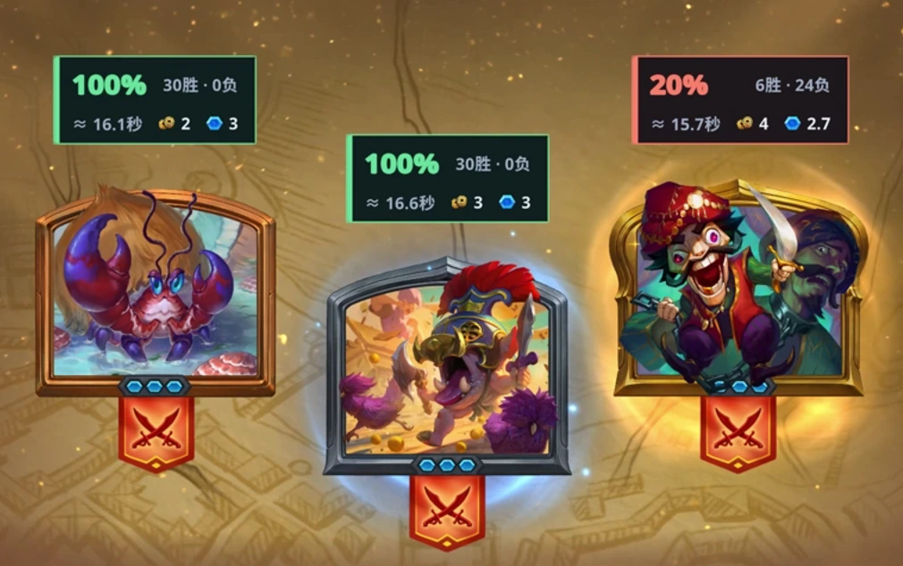
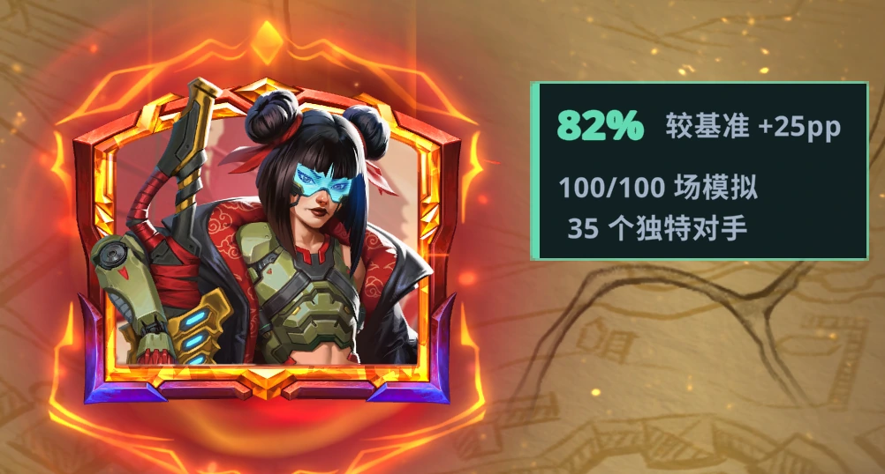
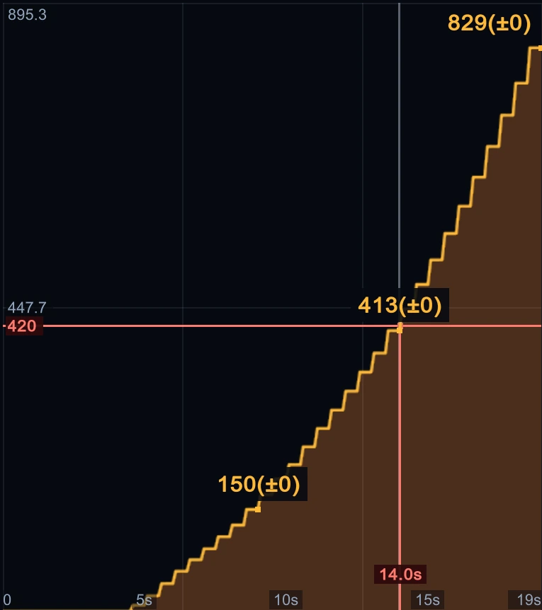
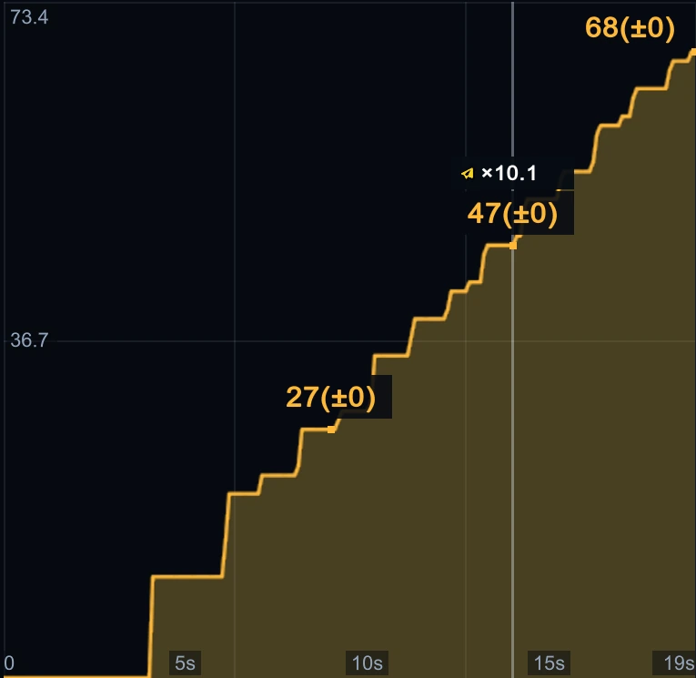
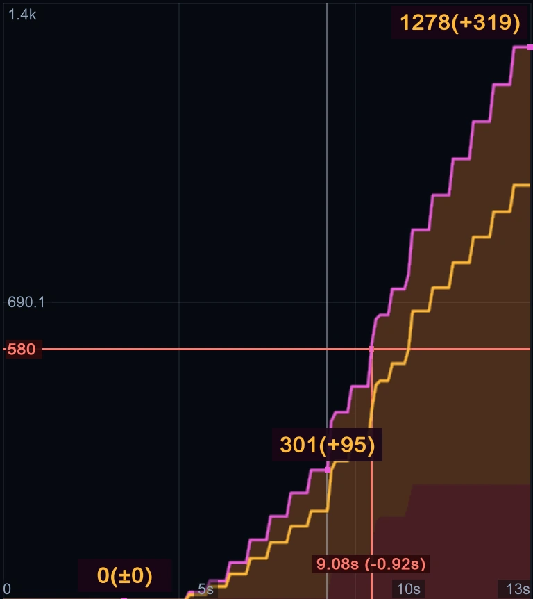
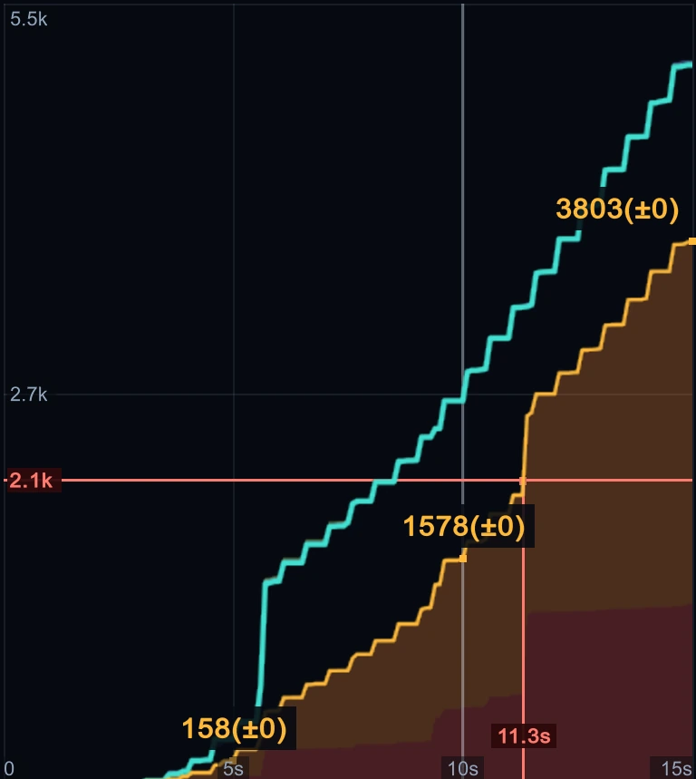
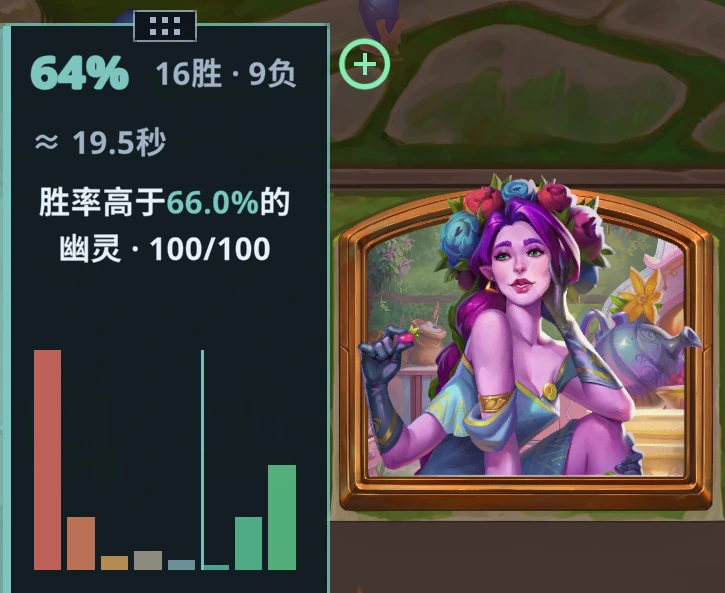
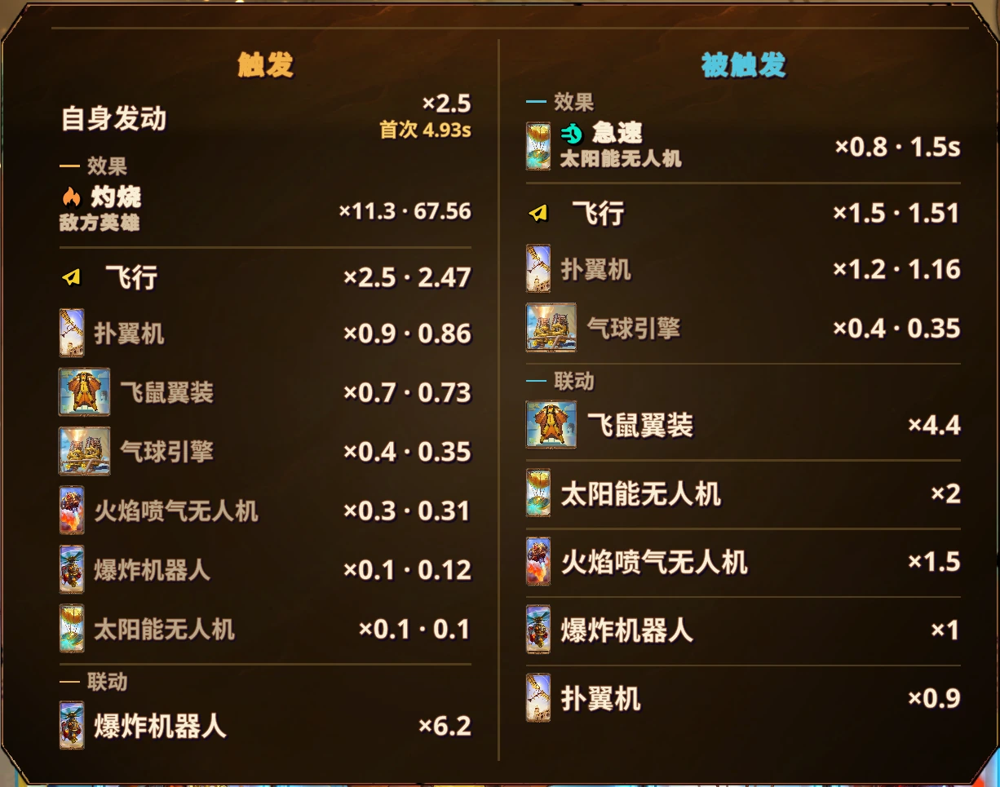
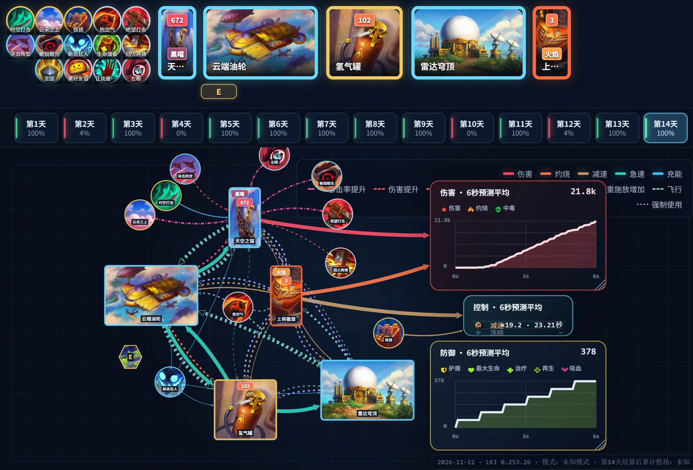
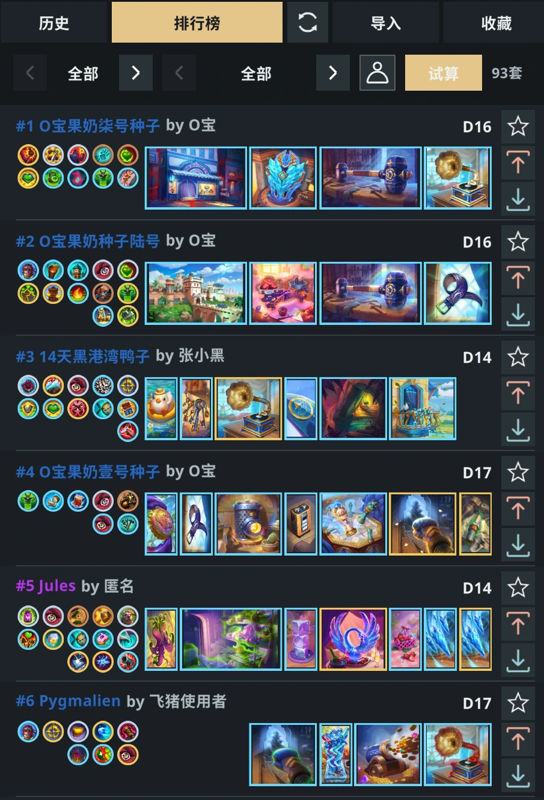

[简体中文](README.md) | **English**

  
  <h1>LookingIN</h1>
  
<strong>Know your odds. Know your build.</strong>

  
Win-rate estimates, build curves, and run reviews for <em>The Bazaar</em>. More information for picking a monster, buying an item, or changing your board. The decision is still yours.

  

    <a href="https://looking1n.com/en/download/"><strong>Download LookingIN</strong></a> ·
    <a href="https://looking1n.com/en/tutorial/">Full guide</a> ·
    <a href="https://looking1n.com/en/arena/">Season rankings</a> ·
    <a href="https://looking1n.com/en/help/">Help & feedback</a>
  

  
Windows x64 · Apple Silicon Mac · Android

---

[Before the fight](#before-the-fight) · [Build decisions](#build-decisions) · [After the fight](#after-the-fight) · [Save and challenge](#save-and-challenge) · [Download and install](#download-and-install)

> These are the same actual desktop screenshots used in the [website feature guide](https://looking1n.com/en/tutorial/#features), with the original Chinese UI. Select an image to view it full-size. Numbers describe those example simulations, not guaranteed outcomes; features and layouts vary by platform and version.

## Before the fight

### Check the odds before choosing a monster

See **simulated win rates** above monster portraits and weigh rewards against risk. Add samples to an existing result instead of relying only on a hunch about whether a fight is worth taking.

  

### How might this build fare in PvP?

Use **historical ghosts from the same season, day, and hero** as a reference before the fight. The estimate describes your build against that sample. It **cannot read your next actual opponent**.

  

## Build decisions

### See what changes when you adjust a build

**Damage and defense curves** show performance over time. Set a baseline to compare before and after a change, choose separate or combined layouts, and drag, resize, and save panel positions.

  
  

### Preview a purchase, upgrade, or enchantment

Hover over a shop item and press the middle mouse button to compare the build after purchasing it. Supported skills, upgrades, and enchantments also offer curve previews. **Compare first, then decide**—the plugin does not buy or sell for you.

  

### Pin your core items and explore the other positions

**Arrangement optimization and stash swaps are Windows/macOS features, not available on Android.** PIN locks item positions during arrangement searches. Apply a recommendation or undo it. Right-click to mark a replaceable item with a question mark, then middle-click a stash candidate to preview a swap.

  

## After the fight

### Bad luck, or room to improve?

Regular PvP shows simulated odds against the actual opponent **when the fight first resolves**. Peer comparisons and distributions put the result in context. Historical samples, actual-opponent simulations, and observed outcomes describe different things and are not interchangeable.

  

### Understand how your items interact

Hover over your board items to inspect **what triggers them and what they trigger** within the evaluation period. When recorded, the first activation time helps explain startup order and interactions, beyond the final numbers.

  

## Save and challenge

### Revisit every day after a run ends

An **offline HTML report** is saved automatically at the end of a run, with daily builds, predictions, and actual outcomes. Open it offline, export PNG images, or copy build share strings.

  

### Save your builds and explore other players' ideas

Browse current-season builds from history, TOPS, imports, and favorites. Filter by hero and day, then run **custom battles**. Builds from different seasons cannot be mixed. Visit the [website season rankings](https://looking1n.com/en/arena/) for more ideas.

  

Other conveniences include stash value and quest hints, continuing automatically after PvE, and muting idle voice lines. Check the current release's settings for available options. Start with one monster fight and one baseline; you do not need to enable everything at once.

## Download and install

**Versions, packages, and checksums are available on the [official download page](https://looking1n.com/en/download/).** GitHub does not distribute installation packages. Automatic updates use Cloudflare.

| Platform | Installation essentials |
| --- | --- |
| **Windows x64** | Install BPP using the website guide, then copy the complete LookingIN folder—not just the DLL. |
| **Apple Silicon Mac** | Requires macOS 14+ and BPP Mac. Run `AllowRun.command` after the first installation or a manual update. Intel/Rosetta are unsupported; the package is not currently Apple-notarized. |
| **Android** | Use the separate **BPPLKI APK**, which loads an installed official game only after its compatibility check passes. Do not use a desktop ZIP. |

Follow the [platform-specific installation guide](https://looking1n.com/en/tutorial/#installation). Update in place without uninstalling or clearing data. Older versions that cannot update automatically should be updated using the website download.

## Distribution, licensing, and SDK

LookingIN is an independent third-party tool for *The Bazaar*, **not an official game product**. Read the [license, risks, and third-party notices](https://looking1n.com/en/policies/#license) before use. Simulations do not guarantee results, and account safety is not promised.

Since November 17, 2026, this repository maintains only the product overview, showcase images, and website links. Software Releases, SDK distribution, legacy distribution history, and Issues are no longer available here. Use the [website help page](https://looking1n.com/en/help/) for support and feedback.

Public LookingIN Compute SDK releases and support have ended. No new SDK delivery, third-party integration support, or future compatibility is promised. Previously released SDK versions retain their MIT license; the licenses of the proprietary plugin, Worker, and other components are unchanged.

---

**[Download LookingIN](https://looking1n.com/en/download/)** · [Full feature guide](https://looking1n.com/en/tutorial/) · [Support the project](https://looking1n.com/en/support/) · [简体中文](README.md)
