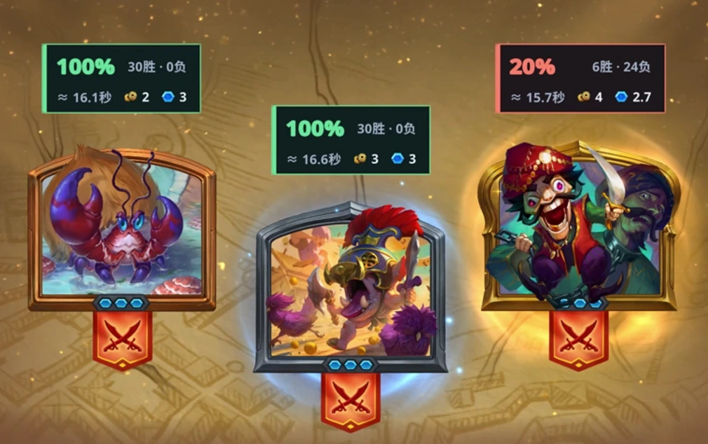
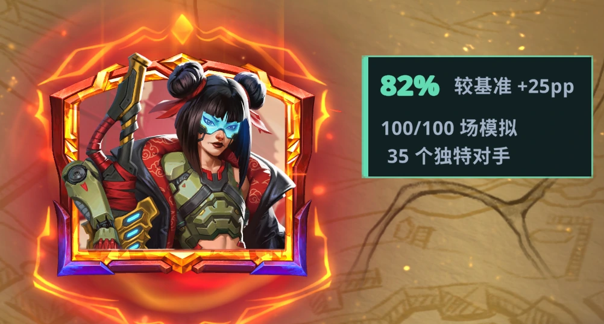
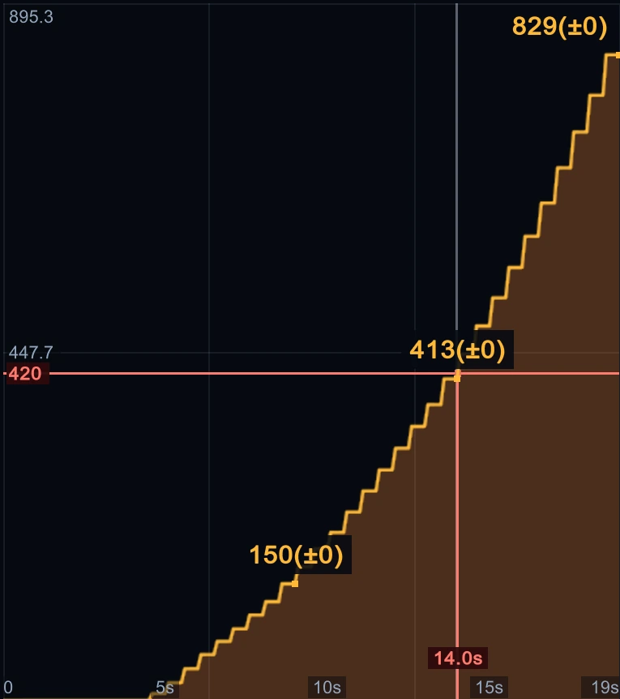
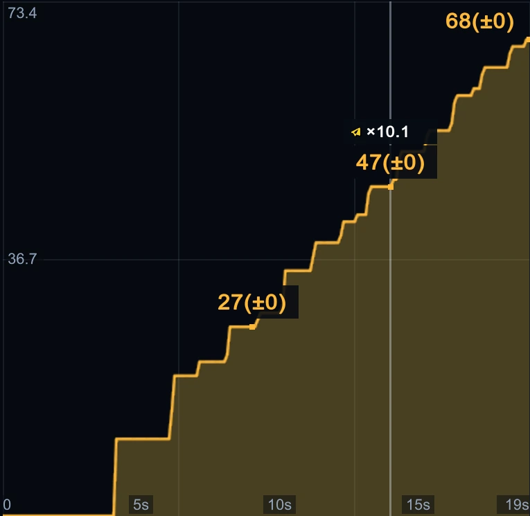
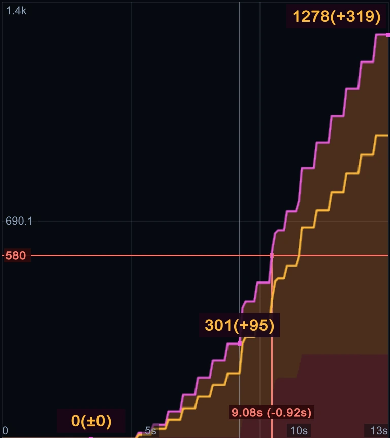
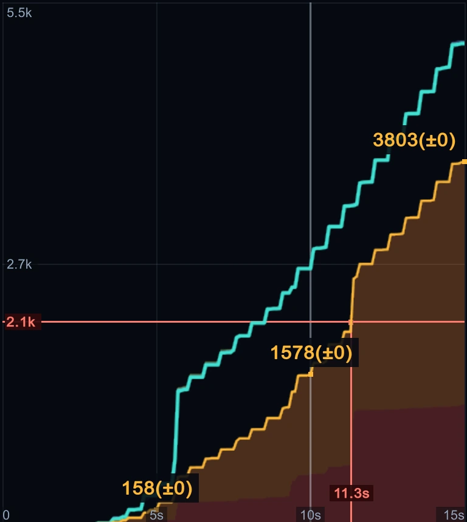
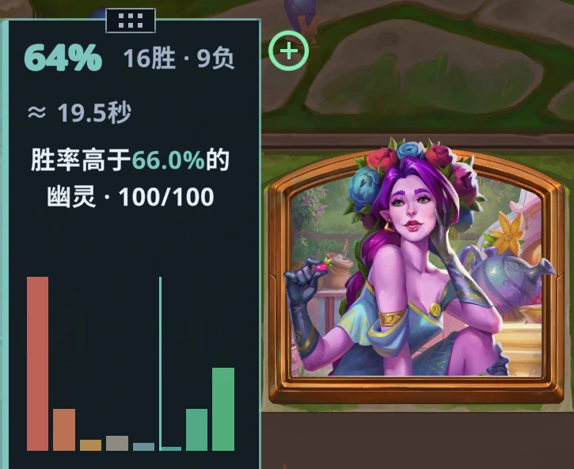
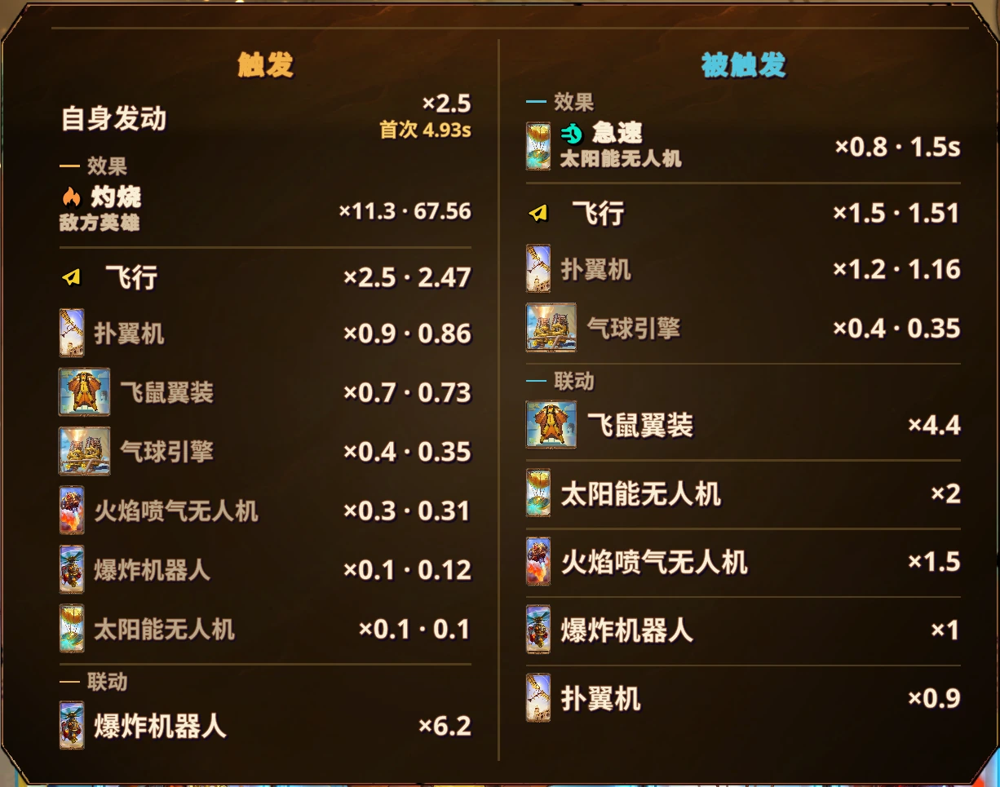
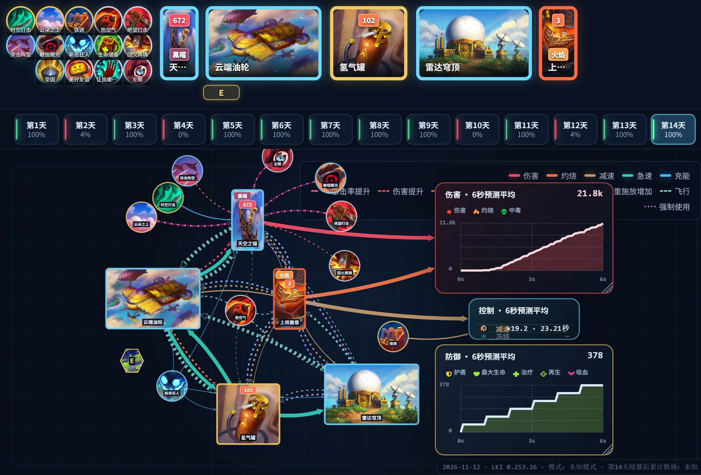
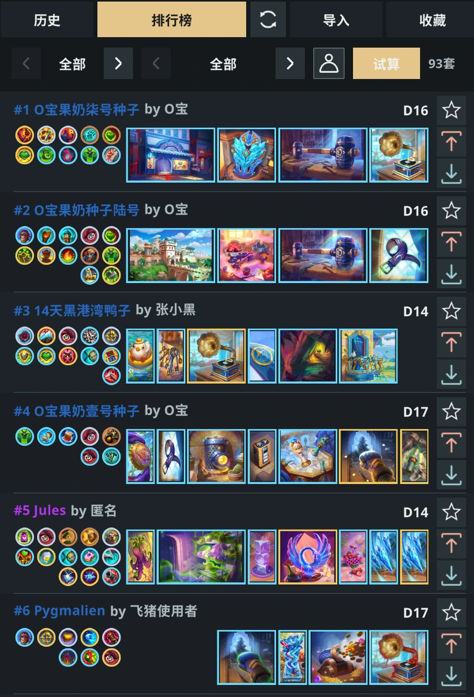

**简体中文** | [English](README.en.md)

  
  <h1>LookingIN</h1>
  
<strong>看见胜率，看懂构筑。</strong>

  
为《The Bazaar》提供胜率估计、构筑曲线与实战复盘。 选野怪、买物品、调排列，多一份依据，决定仍由你。

  

    <a href="https://looking1n.com/download/"><strong>下载 LookingIN</strong></a> ·
    <a href="https://looking1n.com/tutorial/">完整教程</a> ·
    <a href="https://looking1n.com/arena/">赛季榜单</a> ·
    <a href="https://looking1n.com/help/">帮助与反馈</a>
  

  
Windows x64 · Apple Silicon Mac · Android

---

[赛前判断](#赛前判断) · [构筑调整](#构筑调整) · [赛后复盘](#赛后复盘) · [保存与挑战](#保存与挑战) · [下载与安装](#下载与安装)

> 以下图片与[官网功能导览](https://looking1n.com/tutorial/#features)使用同一组桌面实机截图，点击可查看大图。数字仅代表截图当次模拟，不保证胜负；功能与界面以所用平台和版本为准。

## 赛前判断

### 选野怪之前，先看胜率

在野怪头像上方查看当前构筑的**模拟胜率**，结合奖励与风险做选择。已有结果可追加模拟样本，不必只凭感觉判断这一战值不值得打。

  

### 这套构筑，PvP 胜算如何？

用**同赛季、同天数、同角色的历史幽灵**作为赛前参照，了解当前构筑面对这批样本的表现。这里是历史样本预测，**不读取下一位真实对手**。

  

## 构筑调整

### 把“好像更强”，变成看得见的变化

**伤害与防御曲线**展示构筑在不同时点的表现。设置基准线比较调整前后，选择分离式或一体式布局，拖动、缩放并保存面板位置。

  
  

### 买下、升级或附魔前，先试算一次

悬停商店物品并按鼠标中键，比较购买后的构筑；支持的技能、升级与附魔选项也可预览曲线。**先比较，再决定**，不会替你购买或出售。

  

### 固定核心物品，给其他位置多试几种可能

**排列优化与背包替换仅限 Windows／macOS，Android 暂不提供。** 用 PIN 固定物品位置，再搜索排列；推荐可应用，也可撤销。右键用问号标记可替换物品，再中键背包候选进行试算。

  

## 赛后复盘

### 输了，是运气还是构筑？

正式 PvP 在**首次结算后**显示针对实际对手的模拟胜率；同行对照与分布，帮助理解这一次战果。历史样本、真实对手模拟和实际战果是不同的信息，不能相互替代。

  

### 看懂物品之间如何联动

悬停己方场上物品，查看评估时段内**谁触发了它、它又触发了谁**。有记录时显示首次发动时间，帮助分析启动顺序与联动，而不只看最终数字。

  

## 保存与挑战

### 一局结束之后，把每一天重新看一遍

整局结束自动保存 **HTML 离线报告**，按天回看构筑、预测与实际战果。报告可以离线打开，支持导出 PNG 和复制构筑分享串。

  

### 收藏自己的阵容，也试试别人的思路

从历史、TOPS、导入和收藏中浏览当前赛季构筑，按角色与天数筛选，再进行**自定义对战**。构筑不能跨赛季混用；也可以先到[官网赛季榜单](https://looking1n.com/arena/)寻找灵感。

  

还有背包价值与任务提示、PvE 战后自动继续、闲置语音屏蔽等便捷功能。开关以当前正式版设置为准；不需要一次打开全部，从一场野怪战斗和一条基准线开始。

## 下载与安装

**版本、安装包和校验值统一在[官网下载页](https://looking1n.com/download/)提供。** GitHub 不分发安装包，自动更新使用 Cloudflare。

| 平台 | 安装要点 |
| --- | --- |
| **Windows x64** | 先按官网教程安装 BPP，再放入完整的 LookingIN 文件夹，不要只复制 DLL。 |
| **Apple Silicon Mac** | macOS 14+ 与 BPP Mac；首次安装或手动更新后运行 `AllowRun.command`。不支持 Intel／Rosetta，当前未做 Apple 公证。 |
| **Android** | 使用独立的 **BPPLKI APK**，加载手机上已安装且通过适配检查的官方游戏；不使用桌面 ZIP。 |

按[分平台安装教程](https://looking1n.com/tutorial/#installation)操作，更新时覆盖原安装，不要先卸载或清除数据。旧版无法自动更新时，从官网下载并覆盖安装。

## 分发、许可与 SDK

LookingIN 是《The Bazaar》的第三方工具，**不是游戏官方产品**。使用前请阅读[使用许可、风险与第三方声明](https://looking1n.com/policies/#license)。模拟结果不保证胜负，也不承诺账号安全。

自 2026 年 11 月 17 日起，本仓库只维护产品介绍、展示图片与官网入口，不再提供软件 Releases、SDK、旧分发历史或 Issues。帮助与问题反馈请前往[官网帮助页](https://looking1n.com/help/)。

公开 LookingIN Compute SDK 已结束发布与支持，不再提供新版 SDK、第三方接入支持或未来兼容性保证。历史已发布 SDK 的 MIT 许可保持不变；LookingIN 主插件、Worker 等专有组件的许可不因此改变。

---

**[下载 LookingIN](https://looking1n.com/download/)** · [完整功能教程](https://looking1n.com/tutorial/) · [支持项目](https://looking1n.com/support/) · [English](README.en.md)
